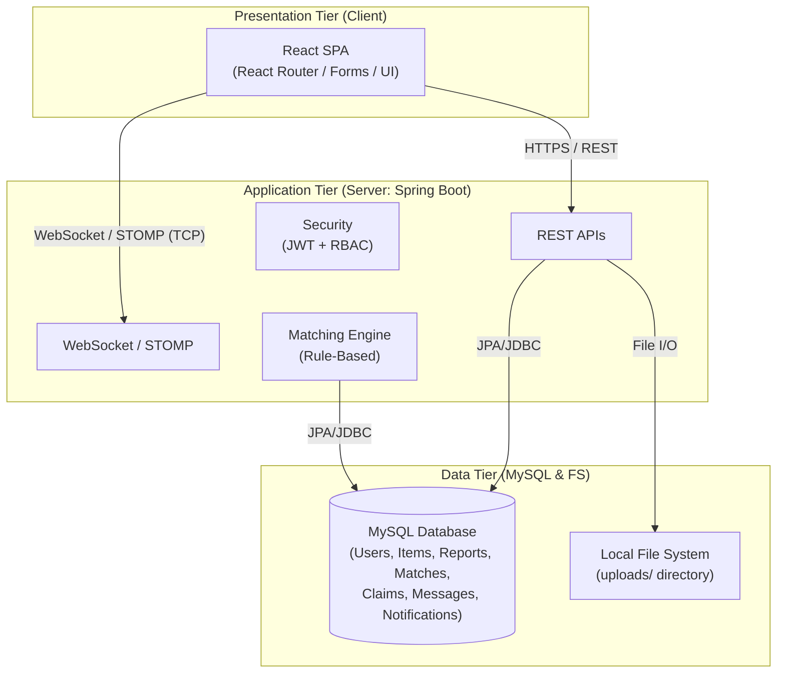
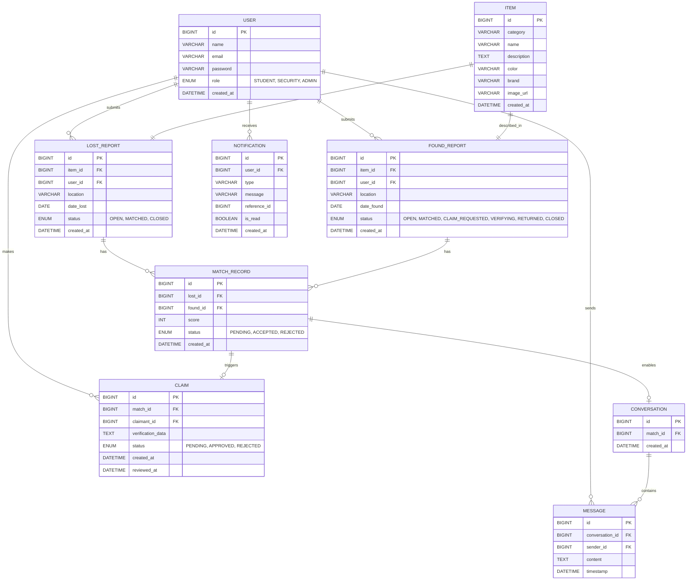
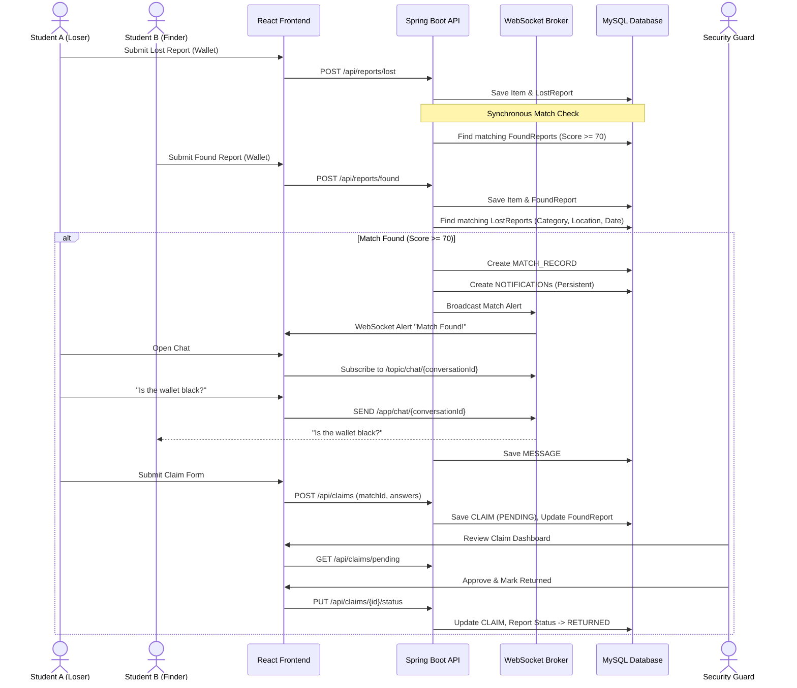
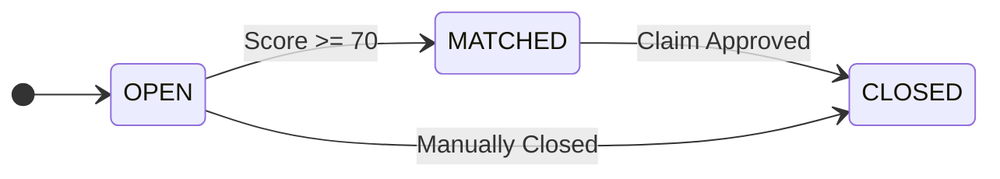
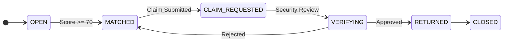
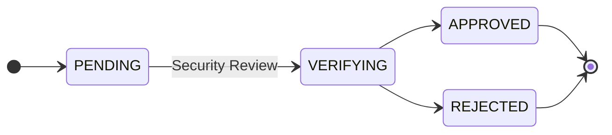
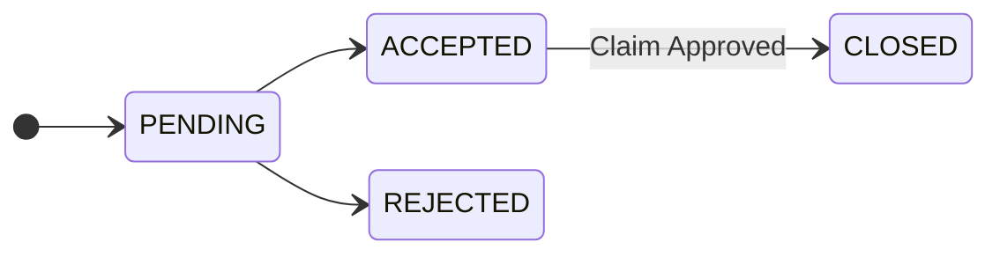
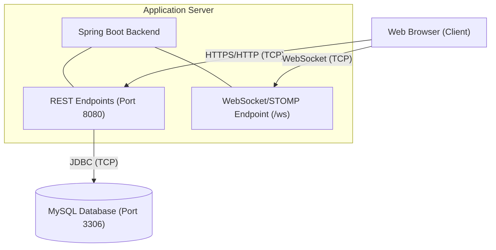

# TraceBack

## Phase 2 — Final System Design

This hybrid document combines exact technical definitions and fixed decisions with visual architecture diagrams for clarity.

### 1. System Architecture

TraceBack follows a strict three-tier enterprise architecture. WebSocket/STOMP remains inside the Spring Boot application tier and is not treated as an independent architectural tier.



---

# 2. Actors

### Student
Can:
* Register/login
* Report lost item
* Report found item
* Search reports
* View possible matches
* Accept/reject matches
* Chat with the other party
* Submit claim
* View notification/status updates

### Security
Can:
* View found items
* Review pending claims
* Verify ownership
* Approve/reject claims
* Mark physical item as returned

### Administrator
Can:
* Manage users
* Moderate inappropriate reports
* View system statistics
* Manage platform-level records
* Manage system configuration

Administrator does not perform physical ownership verification.

---

# 3. Core Modules
* Authentication & Authorization
* Lost Report Management
* Found Report Management
* Search & Filtering
* Matching Engine
* Notification Management
* Real-Time Chat
* Claim Management
* Security Verification
* Administration

---

# 4. Database Design (Entity-Relationship)

An `ITEM` is the common descriptive object, while the report gives it context.
* `USER` 1 ──── N `LOST_REPORT`
* `USER` 1 ──── N `FOUND_REPORT`
* `ITEM` 1 ──── 1 `LOST_REPORT`
* `ITEM` 1 ──── 1 `FOUND_REPORT`



*Note: A unique constraint should prevent the same lost/found pair from being inserted into `MATCH_RECORD` repeatedly. Each match has at most one active `CONVERSATION`, with participants derived dynamically from the matched reports.*

---

# 5. Core System Flow (End-to-End Sequence)



---

# 6. Matching Algorithm

Matching is performed synchronously whenever a new lost or found report is created. No machine learning is required for the MVP.

### Matching criteria
* Category    = 40 points
* Location    = 30 points
* Date        = 30 points

### Date rule
A report matches when: `absolute(date_lost - date_found) <= 2 days`

### Match rule
`score >= 70` creates a `MATCH_RECORD`.

Example:
```text
Category     Match       +40
Location     Match       +30
Date         +1 day      +30
----------------------------
Score                     100
```

---

# 7. State and Workflow Lifecycles

### Lost Report Lifecycle


### Found Report Lifecycle


### Claim Lifecycle


### Match Record Lifecycle


---

# 8. Real-Time Communication

## WebSocket Endpoint
* `/ws`
* Protocol: `STOMP over WebSocket`

## Client → Server
* `/app/chat/{conversationId}`
* Payload:
  ```json
  {
    "content": "Is the wallet black?"
  }
  ```

## Server → Clients
* `/topic/chat/{conversationId}`
* The server persists the message before broadcasting it.

---

# 9. REST API

## Authentication
* `POST /api/auth/register`
* `POST /api/auth/login`

## Reports
* `GET    /api/reports`
* `GET    /api/reports/{id}`
* `POST   /api/reports/lost`
* `POST   /api/reports/found`
* `PUT    /api/reports/{id}`
* `DELETE /api/reports/{id}`
* Supported filters: `type`, `category`, `location`, `status`, `date`

## Matches
* `GET  /api/matches/my-matches`
* `GET  /api/matches/{id}`
* `PUT  /api/matches/{id}/status`

## Claims
* `POST /api/claims`
* `GET  /api/claims/pending`
* `GET  /api/claims/{id}`
* `PUT  /api/claims/{id}/status`
* Access:
  * `/api/claims/pending` → `SECURITY`
  * `/api/claims/{id}/status` → `SECURITY`

## Notifications
* `GET  /api/notifications`
* `PUT  /api/notifications/{id}/read`

## Conversations
* `GET /api/conversations`
* `GET /api/conversations/{id}/messages`

---

# 10. Security Design

* Authentication: `JWT`
* Request: `Authorization: Bearer <token>`
* Password hashing: `BCryptPasswordEncoder`
* Authorization: `Spring Security`, `Role-Based Access Control`

Example:
* **STUDENT**: own reports, own claims, matched conversations
* **SECURITY**: found items, claim verification, physical return
* **ADMIN**: users, moderation, system management

---

# 11. Image Upload Design

* Client: `multipart/form-data`
* Spring Boot Directory:
  ```text
  uploads/
     ├── item_001.jpg
     ├── item_002.jpg
     └── item_003.png
  ```
* Database: `/uploads/item_001.jpg`
* The application must validate: File type, File size, Filename/path safety

---

# 12. Network Architecture



For the project presentation:
* **Application Layer**: HTTP, HTTPS, REST, WebSocket, STOMP, DNS
* **Transport Layer**: TCP
* The separate UDP practical/experiment remains outside the TraceBack application, as decided in Phase 1.

---

# 13. Important Design Rules (LOCKED)

1. Keep the application as a single Spring Boot backend.
2. Do not introduce Node.js.
3. Do not introduce microservices.
4. Do not introduce an external message broker for the MVP.
5. Keep matching deterministic and rule-based.
6. Keep notifications persistent.
7. Keep Security responsible for physical verification.
8. Keep Admin responsible for platform administration.
9. Keep the database relational and normalized.
10. Keep WebSocket/STOMP inside the Spring Boot application tier.

---

# 14. Phase 2 Completion Criteria

Phase 2 is complete when the following are finalized:
* High-level architecture
* Three-tier architecture
* ER diagram
* Entity relationships
* State transitions
* Matching algorithm
* REST API specification
* WebSocket/STOMP specification
* Authentication/authorization design
* Image-storage design
* Network architecture
* Main sequence diagrams
* Component responsibilities

Only after these are approved should development begin.
