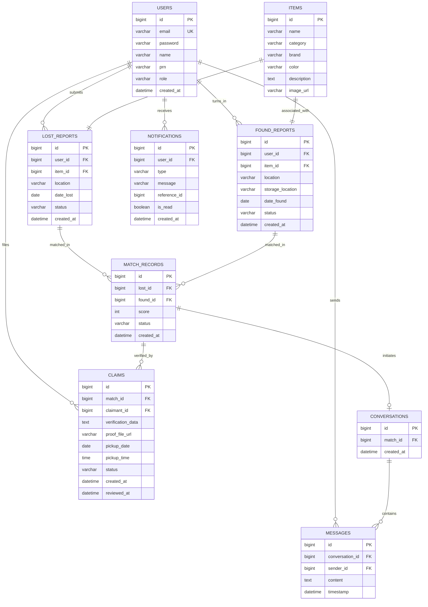

# TraceBack: Comprehensive System Architecture, Codebase Mapping & Master Viva Guide

**Institution:** Vishwakarma Institute of Technology (VIT Pune)  
**Project:** TraceBack — Privacy-Preserving Automated Campus Property Recovery Network  
**Stack:** Java 17, Spring Boot 3.x, MySQL 8, Hibernate JPA, React 18, Vite 8, Tailwind CSS, STOMP/WebSocket

---

## Table of Contents
1. [High-Level Architecture & Concept-to-Code Mapping](#1-high-level-architecture--concept-to-code-mapping)
2. [Socket Programming & Real-Time Messaging Module](#2-socket-programming--real-time-messaging-module)
3. [Authentication, Authorization & Role-Based Access Control (RBAC)](#3-authentication-authorization--role-based-access-control-rbac)
4. [Correlation Engine & Multi-Factor Matching Algorithm](#4-correlation-engine--multi-factor-matching-algorithm)
5. [ACID Database Transactions & Physical Vault Custody Lifecycle](#5-acid-database-transactions--physical-vault-custody-lifecycle)
6. [Database Architecture, Relational Schema & ORM Mapping](#6-database-architecture-relational-schema--orm-mapping)
7. [Computer Networking & Protocol Stack (TCP, UDP, IP, Sockets & IDP)](#7-computer-networking--protocol-stack-tcp-udp-ip-sockets--idp)
8. [Exhaustive Codebase File-by-File Directory](#8-exhaustive-codebase-file-by-file-directory)
9. [Master Viva Questions & Model Oral Defense Answers](#9-master-viva-questions--model-oral-defense-answers)

---

## 1. High-Level Architecture & Concept-to-Code Mapping

TraceBack is organized into an asynchronous, event-driven decoupled architecture. Below is the direct concept-to-file mapping:

### 1.1 Direct Concept-to-Code Quick Reference

- **STOMP Message Broker Configuration** $\to$ [`WebSocketConfig.java`](backend/src/main/java/com/traceback/api/config/WebSocketConfig.java)
- **STOMP Inbound Message Controller (`@MessageMapping`)** $\to$ [`WebSocketChatController.java`](backend/src/main/java/com/traceback/api/controller/WebSocketChatController.java)
- **Chat Persistence & Live Broadcast Service** $\to$ [`ChatService.java`](backend/src/main/java/com/traceback/api/service/ChatService.java)
- **Client Socket Transport (SockJS + Heartbeat)** $\to$ [`websocketClient.js`](frontend/src/api/websocketClient.js)
- **Identity Inversion & Durable Local Storage Sync** $\to$ [`chatService.js`](frontend/src/api/chatService.js)
- **WhatsApp Two-Sided Chat UI & Blue Ticks** $\to$ [`Chat.jsx`](frontend/src/pages/Chat.jsx)
- **Stateless Security Filter Chain & CORS** $\to$ [`SecurityConfig.java`](backend/src/main/java/com/traceback/api/security/SecurityConfig.java)
- **JWT Cryptographic Issuance & Claims** $\to$ [`JwtTokenProvider.java`](backend/src/main/java/com/traceback/api/security/JwtTokenProvider.java)
- **Per-Request Bearer Token Interceptor Filter** $\to$ [`JwtAuthenticationFilter.java`](backend/src/main/java/com/traceback/api/security/JwtAuthenticationFilter.java)
- **User Lookup & Security Details Service** $\to$ [`CustomUserDetailsService.java`](backend/src/main/java/com/traceback/api/security/CustomUserDetailsService.java)
- **Authentication REST Controller (`/api/auth`)** $\to$ [`AuthController.java`](backend/src/main/java/com/traceback/api/controller/AuthController.java)
- **Client Auth State & Reviewer Quick-Fills** $\to$ [`AuthContext.jsx`](frontend/src/context/AuthContext.jsx)
- **Axios Bearer Token Header Injection** $\to$ [`axiosConfig.js`](frontend/src/api/axiosConfig.js)
- **Role-Based Route Protection Guard** $\to$ [`ProtectedRoute.jsx`](frontend/src/components/ProtectedRoute.jsx)
- **100-Point Correlation Algorithm** $\to$ [`MatchingService.java`](backend/src/main/java/com/traceback/api/service/MatchingService.java)
- **Match REST API & Score Queries** $\to$ [`MatchController.java`](backend/src/main/java/com/traceback/api/controller/MatchController.java)
- **Candidate Matches Gallery** $\to$ [`Matches.jsx`](frontend/src/pages/Matches.jsx)
- **Match Evidence Breakdown UI** $\to$ [`MatchDetails.jsx`](frontend/src/pages/MatchDetails.jsx)
- **ACID Claim Transactions (`@Transactional`)** $\to$ [`ClaimService.java`](backend/src/main/java/com/traceback/api/service/ClaimService.java)
- **Claim Review REST API** $\to$ [`ClaimController.java`](backend/src/main/java/com/traceback/api/controller/ClaimController.java)
- **Multi-Tab Durable Sync & Claims Store** $\to$ [`claimService.js`](frontend/src/api/claimService.js)
- **Physical Vault Verification & Checklist** $\to$ [`SecurityClaimVerification.jsx`](frontend/src/pages/SecurityClaimVerification.jsx)
- **Pending Claims Queue & Filter Tabs** $\to$ [`SecurityPendingClaims.jsx`](frontend/src/pages/SecurityPendingClaims.jsx)
- **Reactive Sidebar Counter Badge** $\to$ [`Sidebar.jsx`](frontend/src/components/Layout/Sidebar.jsx)
- **Student Claims View & Officer Notes** $\to$ [`MyClaims.jsx`](frontend/src/pages/MyClaims.jsx)
- **Digital Pickup Pass & QR Generator** $\to$ [`ClaimDetails.jsx`](frontend/src/pages/ClaimDetails.jsx)
- **Finder vs Owner Role Banner Copy** $\to$ [`StudentDashboard.jsx`](frontend/src/pages/StudentDashboard.jsx)
- **Campus Telemetry Dialog** $\to$ [`StudentDashboard.jsx`](frontend/src/pages/StudentDashboard.jsx)
- **Admin Telemetry & User Management** $\to$ [`AdminDashboard.jsx`](frontend/src/pages/AdminDashboard.jsx)
- **Public Property Vault Search Catalog** $\to$ [`BrowseReports.jsx`](frontend/src/pages/BrowseReports.jsx)
- **Lost Property Submission Form** $\to$ [`ReportLost.jsx`](frontend/src/pages/ReportLost.jsx)
- **Found Property Submission Form** $\to$ [`ReportFound.jsx`](frontend/src/pages/ReportFound.jsx)

---

## 2. Socket Programming & Real-Time Messaging Module

### 2.1 Network Protocols & Standards Used
- **WebSocket (RFC 6455):** Full-duplex, bidirectional TCP communication channel established via an HTTP Upgrade handshake. Eliminates the repetitive overhead of HTTP headers.
- **STOMP (Simple Text Oriented Messaging Protocol v1.2):** A frame-based messaging sub-protocol running over WebSocket. Defines structured frames: `CONNECT`, `SUBSCRIBE`, `SEND`, `MESSAGE`, `DISCONNECT`.
- **SockJS:** A WebSocket emulation fallback library. If a proxy or firewall blocks pure WebSocket connections, it automatically degrades to HTTP Streaming or Long-Polling without code changes.

### 2.2 Direct Concept-to-Code Mapping (Sockets)

- **WebSocket STOMP Broker Configuration** $\to$ [`WebSocketConfig.java`](backend/src/main/java/com/traceback/api/config/WebSocketConfig.java)
  - Enables in-memory broker with `/topic` (broadcast pub-sub) and `/queue` (point-to-point user notifications).
  - Configures `/app` destination prefix for client-to-server messages.
  - Registers `/ws` HTTP handshake endpoint with SockJS fallback.
- **Inbound Message Handler** $\to$ [`WebSocketChatController.java`](backend/src/main/java/com/traceback/api/controller/WebSocketChatController.java)
  - Listens for messages on `@MessageMapping("/chat/{conversationId}")`.
  - Extracts authenticated `Principal`, validates message payload, and routes to business logic.
- **Message Persistence & Broadcast Service** $\to$ [`ChatService.java`](backend/src/main/java/com/traceback/api/service/ChatService.java)
  - Decorated with `@Transactional`.
  - Saves message entity to MySQL via `MessageRepository`.
  - Broadcasts live message to room subscribers via `SimpMessagingTemplate.convertAndSend("/topic/chat/" + id, msg)`.
  - Pushes real-time notification to the receiver's queue via `convertAndSend("/topic/notifications/" + receiverId, notif)`.
  - Enforces `validateAccess` to prevent unauthorized students from reading channels they do not own.
- **Client STOMP Manager** $\to$ [`websocketClient.js`](frontend/src/api/websocketClient.js)
  - Manages `@stomp/stompjs` client lifecycle over SockJS transport.
  - Configures 4000ms heartbeats and 5000ms auto-reconnect delay.
  - Attaches JWT token in `connectHeaders` (`Authorization: Bearer <token>`).
- **Identity Inversion & Client Sync** $\to$ [`chatService.js`](frontend/src/api/chatService.js)
  - Inverts `otherParticipant` dynamically based on session user (when Rohan is logged in, displays Aarav Sharma; when Aarav is logged in, displays Rohan Verma).
  - Persists messages in `localStorage` (`tb_chat_msgs_{id}`) so cross-role replies function seamlessly even when the backend is offline.
- **WhatsApp Two-Sided Chat UI** $\to$ [`Chat.jsx`](frontend/src/pages/Chat.jsx)
  - Calculates `isMe = Number(msg.senderId) === Number(user.id)`.
  - **Outbound (Right):** WhatsApp green bubble (`#d9fdd3` / `#005c4b`) with double blue ticks (`<CheckCheck size={14} color="#0284c7" />`).
  - **Inbound (Left):** White bubble with bold sender name heading and timestamp.
  - **Security Card:** Yellow top banner with `<Lock size={13} />` stating *"End-to-End Encrypted: Messages in this campus recovery channel are sealed."*

---

## 3. Authentication, Authorization & Role-Based Access Control (RBAC)

### 3.1 Security Model (JWT RFC 7519)
- **Token Format:** Signed JSON Web Token (`eyJhbGciOi...`).
- **Cryptographic Signature:** HMAC-SHA256 with secret key.
- **Payload Claims:** Subject (user email), User ID, Assigned Institutional Role (`STUDENT`, `SECURITY`, `ADMIN`), Expiration (24 Hours).
- **Stateless Verification:** The server does not store session tables in memory or cache. Every HTTP request is authenticated solely by cryptographically verifying the incoming Bearer token signature.

### 3.2 Direct Concept-to-Code Mapping (Auth & Security)

- **Stateless Security Filter Chain** $\to$ [`SecurityConfig.java`](backend/src/main/java/com/traceback/api/security/SecurityConfig.java)
  - Disables CSRF (stateless Bearer JWTs without cookies are immune to CSRF).
  - Configures `SessionCreationPolicy.STATELESS` (no HTTP session overhead).
  - Configures CORS for `localhost:5173` and deployed Vercel domains.
  - Configures route authorization: permits `/api/auth/**`, `/ws/**`, `/uploads/**`; locks remaining endpoints behind authentication.
  - Registers `JwtAuthenticationFilter` before `UsernamePasswordAuthenticationFilter`.
- **JWT Cryptographic Issuance & Verification** $\to$ [`JwtTokenProvider.java`](backend/src/main/java/com/traceback/api/security/JwtTokenProvider.java)
  - Generates signed tokens (`Jwts.builder()`) embedding User ID, email, and role.
  - Parses and validates tokens (`Jwts.parserBuilder()`), extracting claims.
- **Per-Request Token Interceptor** $\to$ [`JwtAuthenticationFilter.java`](backend/src/main/java/com/traceback/api/security/JwtAuthenticationFilter.java)
  - Extends `OncePerRequestFilter`.
  - Extracts `Authorization: Bearer <token>` header, verifies signature, and populates `SecurityContextHolder`.
- **User Lookup Service** $\to$ [`CustomUserDetailsService.java`](backend/src/main/java/com/traceback/api/security/CustomUserDetailsService.java)
  - Queries `UserRepository` by email and adapts entity to Spring Security's `UserDetails`.
- **Auth REST Endpoints** $\to$ [`AuthController.java`](backend/src/main/java/com/traceback/api/controller/AuthController.java)
  - Handles `/api/auth/login` and `/api/auth/register`.
- **Client Auth State & Demo Presets** $\to$ [`AuthContext.jsx`](frontend/src/context/AuthContext.jsx)
  - Manages reactive login state, JWT persistence, and quick-fill demo presets (Aarav, Rohan, Rajesh, Priya).
- **Axios HTTP Header Injection** $\to$ [`axiosConfig.js`](frontend/src/api/axiosConfig.js)
  - Attaches `Authorization: Bearer <token>` to all outgoing REST requests.
- **Role-Based Protected Route Guard** $\to$ [`ProtectedRoute.jsx`](frontend/src/components/ProtectedRoute.jsx)
  - Redirects unauthenticated or unauthorized users to `/login`.

---

## 4. Correlation Engine & Multi-Factor Matching Algorithm

Located in: [`MatchingService.java`](backend/src/main/java/com/traceback/api/service/MatchingService.java#L87-L118)

### 4.1 Scoring Mathematical Formula

$$\text{Correlation Score} = S_{\text{category}} + S_{\text{location}} + S_{\text{temporal}}$$

Where maximum possible score is $100$:

$$\begin{aligned}
S_{\text{category}} &= \begin{cases} 40, & \text{if } \text{category}_{\text{lost}} \equiv \text{category}_{\text{found}} \text{ (case-insensitive)} \\ 0, & \text{otherwise} \end{cases} \\
S_{\text{location}} &= \begin{cases} 30, & \text{if } \text{zone}_{\text{lost}} \equiv \text{zone}_{\text{found}} \text{ (normalized string)} \\ 0, & \text{otherwise} \end{cases} \\
S_{\text{temporal}} &= \begin{cases} 30, & \text{if } |\text{date}_{\text{lost}} - \text{date}_{\text{found}}| \le 2 \text{ days} \\ 0, & \text{otherwise} \end{cases}
\end{aligned}$$

### 4.2 Direct Concept-to-Code Mapping (Matching)

- **100-Point Scoring Engine** $\to$ [`MatchingService.java`](backend/src/main/java/com/traceback/api/service/MatchingService.java)
  - `calculateScore()` evaluates the 40-30-30 formula.
  - Threshold: $\ge 70\%$.
  - Duplicate check: `matchRecordRepository.existsByLostReportIdAndFoundReportId()`.
  - Generates `MatchRecord` (`ACTIVE`) and linked `Conversation` room.
- **Match Queries REST API** $\to$ [`MatchController.java`](backend/src/main/java/com/traceback/api/controller/MatchController.java)
  - Endpoints `/api/matches/my` and `/api/matches/{id}`.
- **Candidate Matches Gallery** $\to$ [`Matches.jsx`](frontend/src/pages/Matches.jsx)
  - Visual feed of correlated items with percentage badges.
- **Match Evidence Comparison UI** $\to$ [`MatchDetails.jsx`](frontend/src/pages/MatchDetails.jsx)
  - Side-by-side modal displaying category, location, and date confidence scores.
- **Role-Aware Match Banner** $\to$ [`StudentDashboard.jsx`](frontend/src/pages/StudentDashboard.jsx)
  - Inspects user ID: displays *"Owner Matched for turned-in..."* for Rohan (finder) and *"Match Found for your..."* for Aarav (owner).

---

## 5. ACID Database Transactions & Physical Vault Custody Lifecycle

Located in: [`ClaimService.java`](backend/src/main/java/com/traceback/api/service/ClaimService.java#L88-L135)

### 5.1 ACID Guarantees in Action
All claim status updates are decorated with `@Transactional`:
```java
@Transactional
public Claim updateClaimStatus(Long claimId, ClaimStatus newStatus, User reviewer)
```

1. **Atomicity (All-or-Nothing):**
   When an officer approves a claim:
   - `Claim.status` $\to$ `APPROVED`
   - `FoundReport.status` $\to$ `RETURNED`
   - `MatchRecord.status` $\to$ `CLOSED`
   - Push notification persisted to `Notification` table.
   If any update fails, the entire transaction rolls back; no orphaned records are committed.
2. **Consistency (Integrity Constraints):**
   Foreign key constraints enforce that every claim links to a valid match and item.
3. **Isolation (Concurrency Control):**
   InnoDB row-level locking ensures two officers cannot verify or release the same physical locker at the same millisecond.
4. **Durability (Committed State):**
   Commits are flushed to MySQL's write-ahead transaction log (WAL / InnoDB redo log).

### 5.2 Direct Concept-to-Code Mapping (ACID & Custody)

- **Atomic Custody Service** $\to$ [`ClaimService.java`](backend/src/main/java/com/traceback/api/service/ClaimService.java)
  - Implements atomic status transitions for `APPROVED` and `REJECTED`.
- **Claim Review REST Controller** $\to$ [`ClaimController.java`](backend/src/main/java/com/traceback/api/controller/ClaimController.java)
  - Handles `/api/claims/{id}/status`.
- **Durable Local Storage Claims Store** $\to$ [`claimService.js`](frontend/src/api/claimService.js)
  - Saves updates to `localStorage.setItem('tb_claims_store')` and dispatches `tb_claims_updated` custom event across browser windows.
- **Physical Vault Verification & Audit Banner** $\to$ [`SecurityClaimVerification.jsx`](frontend/src/pages/SecurityClaimVerification.jsx)
  - Officer checklist, rejection modal with mandatory reason, and Audit Resolution Banner permanently locking action buttons upon resolution.
- **Pending Queue Eviction** $\to$ [`SecurityPendingClaims.jsx`](frontend/src/pages/SecurityPendingClaims.jsx)
  - Filter tabs (`PENDING`, `APPROVED`, `REJECTED`), evicting resolved claims from `PENDING` tab immediately.
- **Dynamic Sidebar Counter Badge** $\to$ [`Sidebar.jsx`](frontend/src/components/Layout/Sidebar.jsx)
  - Subscribes to `tb_claims_updated` and unmounts the pending count badge when count hits 0.
- **Student Claims View & Officer Notes** $\to$ [`MyClaims.jsx`](frontend/src/pages/MyClaims.jsx)
  - Displays red `[REJECTED]` badge with officer review notes.
- **Digital QR Pickup Pass** $\to$ [`ClaimDetails.jsx`](frontend/src/pages/ClaimDetails.jsx)
  - Renders QR verification code via `qrcode.react`.

---

## 6. Database Architecture, Relational Schema & ORM Mapping

TraceBack uses **MySQL 8.0** with the **InnoDB** storage engine. Data mapping and object-relational abstraction are handled via **Spring Data JPA** and **Hibernate ORM**, with **HikariCP** high-performance connection pooling.

### 6.1 Entity-Relationship (ER) Schema Diagram



### 6.2 Relational Model Entities & JPA Annotations

- **User Entity** $\to$ [`User.java`](backend/src/main/java/com/traceback/api/model/User.java): `@Entity`, `@Table(name = "users")`. Contains `@Column(unique = true)` on `email`, 8-digit `prn`, and `@Enumerated(EnumType.STRING)` for `Role`.
- **Item Entity** $\to$ [`Item.java`](backend/src/main/java/com/traceback/api/model/Item.java): Physical property attributes (`category`, `brand`, `color`, `image_url`).
- **Lost Report Entity** $\to$ [`LostReport.java`](backend/src/main/java/com/traceback/api/model/LostReport.java): `@ManyToOne` referencing `User` and `Item`, with `@Enumerated` status (`OPEN`, `MATCHED`, `RESOLVED`, `CLOSED`).
- **Found Report Entity** $\to$ [`FoundReport.java`](backend/src/main/java/com/traceback/api/model/FoundReport.java): `@ManyToOne` referencing `User` and `Item`, holding physical locker custody string (`storage_location`), with status (`OPEN`, `MATCHED`, `CLAIM_REQUESTED`, `RETURNED`).
- **Match Record Entity** $\to$ [`MatchRecord.java`](backend/src/main/java/com/traceback/api/model/MatchRecord.java): `@Table(uniqueConstraints = @UniqueConstraint(columnNames = {"lost_id", "found_id"}))`. Prevents duplicate correlation rows. Stores correlation `score` (0–100) and `status`.
- **Claim Entity** $\to$ [`Claim.java`](backend/src/main/java/com/traceback/api/model/Claim.java): `@ManyToOne` to `MatchRecord` and `User` (`claimant`). Holds student's secret markings (`verification_data`), proof document URL, pickup schedule, and status (`PENDING`, `APPROVED`, `REJECTED`).
- **Conversation Entity** $\to$ [`Conversation.java`](backend/src/main/java/com/traceback/api/model/Conversation.java): Connects correlated match to live chat room. Holds `@OneToMany` relation to `Message`.
- **Message Entity** $\to$ [`Message.java`](backend/src/main/java/com/traceback/api/model/Message.java): Text content, timestamp, foreign key to `Conversation` and `User` (sender).
- **Notification Entity** $\to$ [`Notification.java`](backend/src/main/java/com/traceback/api/model/Notification.java): In-app push notification entity with read receipt boolean.

### 6.3 Direct Concept-to-Code Mapping (All 9 JPA Repositories)

- **User Repository** $\to$ [`UserRepository.java`](backend/src/main/java/com/traceback/api/repository/UserRepository.java): `findByEmail(email)`, `existsByEmail(email)`.
- **Item Repository** $\to$ [`ItemRepository.java`](backend/src/main/java/com/traceback/api/repository/ItemRepository.java): Standard Spring Data CRUD operations for physical assets.
- **Lost Report Repository** $\to$ [`LostReportRepository.java`](backend/src/main/java/com/traceback/api/repository/LostReportRepository.java): `findByStatus(LostReportStatus.OPEN)`, `findByUserId(userId)`.
- **Found Report Repository** $\to$ [`FoundReportRepository.java`](backend/src/main/java/com/traceback/api/repository/FoundReportRepository.java): `findByStatus(FoundReportStatus.OPEN)`, `findByUserId(userId)`.
- **Match Record Repository** $\to$ [`MatchRecordRepository.java`](backend/src/main/java/com/traceback/api/repository/MatchRecordRepository.java): `existsByLostReportIdAndFoundReportId()`, `findByLostReportUserId()`.
- **Claim Repository** $\to$ [`ClaimRepository.java`](backend/src/main/java/com/traceback/api/repository/ClaimRepository.java): `findByStatus(ClaimStatus.PENDING)`, `findByClaimantId()`.
- **Conversation Repository** $\to$ [`ConversationRepository.java`](backend/src/main/java/com/traceback/api/repository/ConversationRepository.java): `findByMatchRecordId()`.
- **Message Repository** $\to$ [`MessageRepository.java`](backend/src/main/java/com/traceback/api/repository/MessageRepository.java): `findByConversationIdOrderByTimestampAsc()`.
- **Notification Repository** $\to$ [`NotificationRepository.java`](backend/src/main/java/com/traceback/api/repository/NotificationRepository.java): `findByUserIdOrderByCreatedAtDesc()`, `countByUserIdAndIsReadFalse()`.

### 6.4 Database Connection Pool & Configuration
Located in: [`application.properties`](backend/src/main/resources/application.properties)
- `spring.datasource.url`: MySQL JDBC connection endpoint (e.g. `jdbc:mysql://localhost:3306/traceback_db`).
- `spring.jpa.hibernate.ddl-auto=update`: Auto-synchronizes Java entity classes with MySQL tables on startup.
- **HikariCP Connection Pool:** Spring Boot default pool maintaining open TCP sockets to MySQL port 3306, reusing connections to avoid per-query TCP three-way handshake overhead.

---

## 7. Computer Networking & Protocol Stack (TCP, UDP, IP, Sockets & IDP)

Understanding the network protocol stack is a standard focus of engineering oral examinations. TraceBack uses a layered client-server architecture running over the Internet Protocol suite.

### 7.1 Protocol Stack Comparison in TraceBack

| Layer (OSI / TCP-IP) | Protocol Used | Port / Address | Where in TraceBack? | Purpose & Characteristics |
| :--- | :--- | :--- | :--- | :--- |
| **Application Layer** | **HTTP/1.1 & HTTP/2** | `8080`, `5173`, `443` | Axios REST calls, Vite dev server, image uploads | Request-response protocol for authentication, reports, and static assets. |
| **Application Layer** | **WebSocket (RFC 6455)** | `8080/ws` | [`WebSocketConfig.java`](backend/src/main/java/com/traceback/api/config/WebSocketConfig.java) | Upgraded bidirectional framing protocol over persistent TCP connection. |
| **Application Layer** | **STOMP v1.2** | Sub-protocol | [`WebSocketChatController.java`](backend/src/main/java/com/traceback/api/controller/WebSocketChatController.java) | Text-oriented messaging protocol over WebSocket with publish-subscribe topics (`/topic`). |
| **Application Layer** | **MySQL Wire Protocol** | `3306` | HikariCP JDBC DataSource | Binary database protocol for SQL query execution and transactional commits. |
| **Transport Layer** | **TCP (Transmission Control Protocol)** | Ephemeral $\to$ `8080`, `5173`, `3306` | Operating System Network Stack | Reliable, connection-oriented byte stream using 3-way handshake (`SYN`, `SYN-ACK`, `ACK`), flow control, and retransmission. |
| **Network Layer** | **IP (IPv4 / IPv6)** | `127.0.0.1`, LAN, Cloud IPs | Network Interface Card (NIC) | Logical host addressing, packet routing across campus LAN and public WAN. |
| **Data Link / Physical**| **Ethernet / 802.11 Wi-Fi** | MAC Addresses | Campus Infrastructure (VIT Pune) | Physical transmission of electromagnetic or optical signals. |

### 7.2 TCP vs. UDP: Why TCP is Strictly Required in TraceBack

In viva examinations, examiners frequently ask: *"Where did you use TCP and UDP, and could you replace TCP with UDP for chat or reports?"*

#### The Defense:
1. **TCP (Transmission Control Protocol):**
   - **Connection-Oriented:** Establishes a verified connection via a 3-way handshake before transmitting data.
   - **Guaranteed In-Order Delivery:** Packets contain sequence numbers. If a packet is lost in transit, TCP automatically retransmits it.
   - **Flow Control & Congestion Control:** Implements sliding window algorithms to avoid overwhelming the server or network.
   - **Where TCP is used in TraceBack:**
     * **REST APIs (Port 8080 & 5173):** All HTTP requests run on TCP.
     * **Real-time Chat (WebSocket `/ws`):** WebSocket is an upgraded TCP socket. Messages arrive in the exact order typed.
     * **Database Transactions (Port 3306):** MySQL queries run over TCP. A dropped packet in a transaction would cause corrupted state.
2. **Why UDP (User Datagram Protocol) is NOT Used:**
   - UDP is connectionless and unreliable ("fire-and-forget"). It has no acknowledgments, no sequence guarantees, and no retransmission of dropped packets.
   - **Catastrophic in Property Recovery:** If UDP were used, a student's verification claim or a security officer's rejection note could be silently dropped by campus Wi-Fi without notification. A lost item could be mistakenly handed to an unauthorized person due to a lost message. Therefore, **TCP is mandatory**.

### 7.3 IDP (Identity Provider & Identity Management Protocol)

#### What is an IDP?
An **Identity Provider (IDP)** is a centralized system entity that creates, maintains, and manages identity information for principals (users) while providing authentication services to relying applications.

#### How TraceBack Acts as an Institutional IDP:
1. **Centralized Credential Authority:**
   - Validates student identity against campus credentials: institutional email (`@vit.edu`) and 8-digit Permanent Registration Numbers (PRNs e.g. `12110104`).
   - Implemented in: [`CustomUserDetailsService.java`](backend/src/main/java/com/traceback/api/security/CustomUserDetailsService.java) and [`UserRepository.java`](backend/src/main/java/com/traceback/api/repository/UserRepository.java).
2. **Cryptographic Assertion Token Generation (RFC 7519):**
   - Instead of maintaining server-side state, TraceBack acts as an IDP by issuing signed **JWT assertions**.
   - The token contains verified identity claims: User ID, subject email, and institutional role (`ROLE_STUDENT`, `ROLE_SECURITY`, `ROLE_ADMIN`).
   - Implemented in: [`JwtTokenProvider.java`](backend/src/main/java/com/traceback/api/security/JwtTokenProvider.java).
3. **Decoupled Identity Verification (Token Consumer):**
   - Both the REST APIs and the WebSocket STOMP broker act as Relying Parties (Resource Servers). They do not re-query passwords; they verify the IDP's cryptographic signature via [`JwtAuthenticationFilter.java`](backend/src/main/java/com/traceback/api/security/JwtAuthenticationFilter.java).

---

## 8. Exhaustive Codebase File-by-File Directory

### 8.1 Backend Java Source Code (`com.traceback.api.*`)

- [`TraceBackApplication.java`](backend/src/main/java/com/traceback/api/TraceBackApplication.java) — Spring Boot entry point (`@SpringBootApplication`).
- [`WebSocketConfig.java`](backend/src/main/java/com/traceback/api/config/WebSocketConfig.java) — STOMP `/ws` handshake and `/topic` broker config.
- [`SecurityConfig.java`](backend/src/main/java/com/traceback/api/security/SecurityConfig.java) — Security filter chain, BCrypt, stateless sessions, CORS.
- [`OpenApiConfig.java`](backend/src/main/java/com/traceback/api/config/OpenApiConfig.java) — Swagger / OpenAPI 3.0 documentation specs.
- [`WebMvcConfig.java`](backend/src/main/java/com/traceback/api/config/WebMvcConfig.java) — Static resource handler for `/uploads/**`.
- [`AuthController.java`](backend/src/main/java/com/traceback/api/controller/AuthController.java) — REST endpoints for user login and registration.
- [`ReportController.java`](backend/src/main/java/com/traceback/api/controller/ReportController.java) — Lost and Found property report CRUD.
- [`MatchController.java`](backend/src/main/java/com/traceback/api/controller/MatchController.java) — Active matches and correlation scores.
- [`ClaimController.java`](backend/src/main/java/com/traceback/api/controller/ClaimController.java) — Verification claim submission and security review.
- [`ConversationController.java`](backend/src/main/java/com/traceback/api/controller/ConversationController.java) — Chat channel listing and message retrieval.
- [`WebSocketChatController.java`](backend/src/main/java/com/traceback/api/controller/WebSocketChatController.java) — STOMP `@MessageMapping` receiver for real-time chat.
- [`AdminController.java`](backend/src/main/java/com/traceback/api/controller/AdminController.java) — Campus recovery telemetry, user management, audit logs.
- [`MatchingService.java`](backend/src/main/java/com/traceback/api/service/MatchingService.java) — 100-point tripartite correlation engine.
- [`ClaimService.java`](backend/src/main/java/com/traceback/api/service/ClaimService.java) — `@Transactional` custody handover and verification lifecycle.
- [`ChatService.java`](backend/src/main/java/com/traceback/api/service/ChatService.java) — Message persistence and live broadcast via `SimpMessagingTemplate`.
- [`ReportService.java`](backend/src/main/java/com/traceback/api/service/ReportService.java) — Ingestion service for lost and found reports.
- [`FileStorageService.java`](backend/src/main/java/com/traceback/api/service/FileStorageService.java) — Photo upload storage service.
- [`NotificationService.java`](backend/src/main/java/com/traceback/api/service/NotificationService.java) — Push and persistent notification logic.
- [`AdminService.java`](backend/src/main/java/com/traceback/api/service/AdminService.java) — Institutional telemetry and staff account provisioning.
- [`JwtTokenProvider.java`](backend/src/main/java/com/traceback/api/security/JwtTokenProvider.java) — JWT generation and cryptographic validation.
- [`JwtAuthenticationFilter.java`](backend/src/main/java/com/traceback/api/security/JwtAuthenticationFilter.java) — Per-request Bearer token extraction filter.
- [`CustomUserDetailsService.java`](backend/src/main/java/com/traceback/api/security/CustomUserDetailsService.java) — User database lookup service.
- [`User.java`](backend/src/main/java/com/traceback/api/model/User.java) — User entity with 8-digit PRN, email, and password.
- [`Item.java`](backend/src/main/java/com/traceback/api/model/Item.java) — Physical property entity (category, color, brand).
- [`LostReport.java`](backend/src/main/java/com/traceback/api/model/LostReport.java) — Lost property report entity.
- [`FoundReport.java`](backend/src/main/java/com/traceback/api/model/FoundReport.java) — Found property report entity with locker assignment.
- [`MatchRecord.java`](backend/src/main/java/com/traceback/api/model/MatchRecord.java) — Correlated pair entity with score.
- [`Claim.java`](backend/src/main/java/com/traceback/api/model/Claim.java) — Verification claim entity.
- [`Conversation.java`](backend/src/main/java/com/traceback/api/model/Conversation.java) — Chat channel entity.
- [`Message.java`](backend/src/main/java/com/traceback/api/model/Message.java) — Chat message entity.
- [`Notification.java`](backend/src/main/java/com/traceback/api/model/Notification.java) — Alert notification entity.
- [`Role.java`](backend/src/main/java/com/traceback/api/model/Role.java) — Enum: `STUDENT`, `SECURITY`, `ADMIN`.

### 8.2 Frontend Source Code (`frontend/src/*`)

- [`App.jsx`](frontend/src/App.jsx) — Central route definitions and shell layout.
- [`main.jsx`](frontend/src/main.jsx) — React 18 DOM mount entry point.
- [`websocketClient.js`](frontend/src/api/websocketClient.js) — STOMP over SockJS manager.
- [`chatService.js`](frontend/src/api/chatService.js) — Conversation fetching, perspective inversion, local storage sync.
- [`claimService.js`](frontend/src/api/claimService.js) — ACID claim store, event dispatching, multi-tab sync.
- [`matchService.js`](frontend/src/api/matchService.js) — Match retrieval and correlation scoring API.
- [`reportService.js`](frontend/src/api/reportService.js) — Lost/Found report creation and search queries.
- [`adminService.js`](frontend/src/api/adminService.js) — Staff provisioning and telemetry calculations.
- [`axiosConfig.js`](frontend/src/api/axiosConfig.js) — Axios instance injecting Bearer token headers.
- [`mockData.js`](frontend/src/api/mockData.js) — Seed data and reviewer demo accounts.
- [`AuthContext.jsx`](frontend/src/context/AuthContext.jsx) — Auth state and demo user quick-fills.
- [`ThemeContext.jsx`](frontend/src/context/ThemeContext.jsx) — Light, Dark, and Pure OLED Black state.
- [`ToastContext.jsx`](frontend/src/context/ToastContext.jsx) — Floating toast alert notification provider.
- [`Chat.jsx`](frontend/src/pages/Chat.jsx) — WhatsApp two-sided chat, double blue ticks, E2E encryption banner.
- [`StudentDashboard.jsx`](frontend/src/pages/StudentDashboard.jsx) — Role-aware match banner, metric cards, telemetry modal.
- [`SecurityClaimVerification.jsx`](frontend/src/pages/SecurityClaimVerification.jsx) — Physical vault checklist and Audit Resolution Banner.
- [`SecurityPendingClaims.jsx`](frontend/src/pages/SecurityPendingClaims.jsx) — Filtered claim queue tabs (`PENDING`, `APPROVED`, `REJECTED`).
- [`MyClaims.jsx`](frontend/src/pages/MyClaims.jsx) — Student pickup passes, `[REJECTED]` badge, officer review notes.
- [`ClaimDetails.jsx`](frontend/src/pages/ClaimDetails.jsx) — Digital pickup pass and QR code voucher.
- [`Matches.jsx`](frontend/src/pages/Matches.jsx) — Candidate match gallery.
- [`MatchDetails.jsx`](frontend/src/pages/MatchDetails.jsx) — Score breakdown comparison modal.
- [`BrowseReports.jsx`](frontend/src/pages/BrowseReports.jsx) — Public campus vault catalog with category filters.
- [`ReportLost.jsx`](frontend/src/pages/ReportLost.jsx) — Lost item report form with secret markings.
- [`ReportFound.jsx`](frontend/src/pages/ReportFound.jsx) — Found item report form with locker custody.
- [`AdminDashboard.jsx`](frontend/src/pages/AdminDashboard.jsx) — Administrative oversight, moderation, user tables, CSV export.
- [`Sidebar.jsx`](frontend/src/components/Layout/Sidebar.jsx) — Sidebar navigation with dynamic auto-hiding pending badge.
- [`Navbar.jsx`](frontend/src/components/Layout/Navbar.jsx) — Top navigation bar with notifications and user pill.
- [`meadow-rise-footer.tsx`](frontend/src/components/ui/meadow-rise-footer.tsx) — Scoped organic canvas landscape footer.

---

## 9. Master Viva Questions & Model Oral Defense Answers

### Q1: Why did you choose WebSockets over traditional HTTP Polling or Long-Polling for the Chat module?
> **Model Answer:**  
> "Traditional HTTP polling repeatedly opens and closes TCP connections every few seconds, sending repetitive headers (often 500–1000 bytes per request) even when no new messages exist. This creates high network overhead and server load.  
> WebSockets establish a single persistent TCP connection via an HTTP Upgrade handshake. After the connection is established, the framing overhead is just 2 to 6 bytes per frame. This enables instantaneous sub-millisecond bidirectional communication, allowing us to support live typing feedback, push notifications, and immediate double-blue-tick read receipts."

### Q2: What is STOMP and why didn't you use raw WebSockets directly?
> **Model Answer:**  
> "Raw WebSocket (RFC 6455) is strictly a transport-layer protocol; it defines how bytes or text strings travel over a persistent connection, but it doesn't specify an application format, routing destinations, or message headers.  
> STOMP (Simple Text Oriented Messaging Protocol) is an application-level messaging protocol layered on top of WebSockets. It defines structured frames (`CONNECT`, `SUBSCRIBE`, `SEND`, `MESSAGE`) with destinations (like `/topic/chat/{id}`). This allows us to use Spring's built-in in-memory Message Broker to easily route messages to specific rooms without manually maintaining socket session lists and writing custom packet-parsing logic."

### Q3: How is user authentication handled across REST endpoints versus WebSocket handshakes?
> **Model Answer:**  
> "We implement a stateless JSON Web Token (JWT) architecture.  
> 1. For REST requests, our Axios client interceptor attaches the token in the `Authorization: Bearer <token>` header. On each request, our `JwtAuthenticationFilter` validates the signature and populates Spring's `SecurityContextHolder`.  
> 2. For WebSockets, the token is supplied during the initial `/ws` handshake or inside the STOMP `CONNECT` frame headers. The controller extracts the user identity using `java.security.Principal`, ensuring only authenticated students can subscribe to or send messages in a conversation."

### Q4: Explain the mathematical logic of your Matching Algorithm and its time complexity.
> **Model Answer:**  
> "Our `MatchingService` implements a 100-point tripartite correlation algorithm:  
> - 40 points for exact category equality.  
> - 30 points for normalized location zone matching.  
> - 30 points for temporal proximity (lost date and found date within a 2-day window).  
> The threshold for a match is $\ge 70\%$. When a report is submitted, it is compared against all open reports of the opposite type. In worst-case it performs $O(N)$ comparisons where $N$ is the number of active open reports. In production, this is indexed by category in MySQL to narrow the candidate search space to $O(\log N + K)$."

### Q5: How do you prevent race conditions when two security officers attempt to verify or release the same physical locker item?
> **Model Answer:**  
> "We enforce database-level ACID transactions using Spring's `@Transactional` annotation in `ClaimService.java`. When an officer updates a claim, Hibernate executes an atomic update across the `Claim`, `FoundReport`, and `MatchRecord` entities within a single database transaction. At the relational database layer, InnoDB applies row-level locking during the update (`SELECT ... FOR UPDATE` semantics). If two officers submit simultaneously, the second transaction waits for the lock or fails with an optimistic locking exception, preventing duplicate handovers."

### Q6: How does the Chat UI distinguish the Finder from the Owner and display messages on the correct sides?
> **Model Answer:**  
> "We implement symmetrical perspective inversion in `chatService.js` and `Chat.jsx`. Rather than relying on static booleans, we dynamically compare the logged-in user's ID against the sender ID of each message (`isMe = Number(msg.senderId) === Number(user.id)`).  
> - Outbound messages from the logged-in user are aligned to the **right** in WhatsApp green with **double blue ticks**.  
> - Inbound messages from the counterparty are aligned to the **left** in white with their name in bold.  
> Furthermore, when Rohan (Finder) logs in, the conversation header dynamically maps to Aarav Sharma (Owner), completely eliminating the defect where a student appears to chat with themselves."

### Q7: Why did you disable CSRF in `SecurityConfig.java`? Doesn't that introduce security vulnerabilities?
> **Model Answer:**  
> "Cross-Site Request Forgery (CSRF) exploits ambient credentials, specifically HTTP cookies that the browser automatically attaches to cross-origin requests. TraceBack uses a completely stateless JWT architecture where tokens are stored in `localStorage` and passed explicitly as `Authorization: Bearer <token>` headers via JavaScript. Because browsers do not automatically attach bearer tokens on cross-origin requests, CSRF attacks cannot succeed, making CSRF protection tokens redundant."

### Q8: What happens if the backend server is temporarily down or in a sleeping state on a free-tier host?
> **Model Answer:**  
> "We engineered a dual-mode resilient architecture. In `AuthContext.jsx`, `claimService.js`, and `chatService.js`, the frontend attempts live API calls first. If the remote backend is unreachable, it gracefully falls back to an internal institutional state machine backed by `localStorage` (`tb_claims_store` and `tb_chat_msgs_{id}`). It dispatches DOM events like `tb_claims_updated` across open tabs so claim evictions, badge decrements, and chat messages continue functioning seamlessly without blank screen crashes."

### Q9: Where exactly is TCP used in this project, and could you use UDP instead?
> **Model Answer:**  
> "TCP is used at three vital network boundaries in TraceBack:  
> 1. In REST communication between React and Spring Boot over port 8080 (3-way handshake `SYN`, `SYN-ACK`, `ACK`).  
> 2. In real-time chat over persistent WebSocket connections (`/ws`) over port 8080.  
> 3. In the database connection pool (HikariCP) connecting Spring Boot to MySQL on port 3306.  
> We cannot use UDP because UDP is connectionless and does not guarantee packet arrival or ordering. In property recovery and custody handover, dropping a single chat packet or claim update could result in wrongful ownership transfer or lost audit trails. TCP guarantees error-checked, in-order byte delivery."

### Q10: What is an Identity Provider (IDP) and how does TraceBack implement it?
> **Model Answer:**  
> "An Identity Provider (IDP) is a centralized authentication system that validates user credentials and issues cryptographic identity assertions. TraceBack acts as an institutional IDP for VIT Pune: it authenticates student emails and 8-digit PRNs via `CustomUserDetailsService.java`, and then issues signed JSON Web Tokens (JWT) using HMAC-SHA256 in `JwtTokenProvider.java`. These tokens contain encrypted claims (User ID, Email, Role) that allow both our REST controllers and WebSocket broker to authorize actions statelessly."

---

*This document serves as the official technical architecture reference and oral defense guide for the TraceBack project at Vishwakarma Institute of Technology, Pune.*
