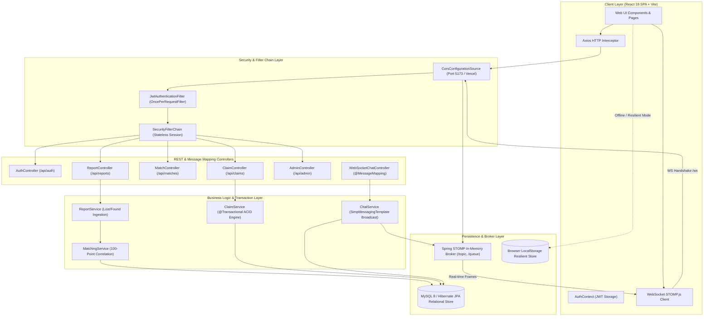

# TraceBack: Comprehensive System Architecture, Codebase Mapping & Master Viva Guide

**Institution:** Vishwakarma Institute of Technology (VIT Pune)  
**Project:** TraceBack — Privacy-Preserving Automated Campus Property Recovery Network  
**Target Repository:** `c:\Users\lakha\CNT_CP\TraceBack`  
**Stack:** Java 17, Spring Boot 3.x, MySQL 8, Hibernate JPA, React 18, Vite 8, Tailwind CSS, STOMP/WebSocket

---

## Table of Contents
1. [High-Level Architecture & System Workflow](#1-high-level-architecture--system-workflow)
2. [Socket Programming & Real-Time Messaging Module](#2-socket-programming--real-time-messaging-module)
3. [Authentication, Authorization & Role-Based Access Control (RBAC)](#3-authentication-authorization--role-based-access-control-rbac)
4. [Correlation Engine & Multi-Factor Matching Algorithm](#4-correlation-engine--multi-factor-matching-algorithm)
5. [ACID Database Transactions & Physical Vault Custody Lifecycle](#5-acid-database-transactions--physical-vault-custody-lifecycle)
6. [Exhaustive Codebase File-by-File Mapping](#6-exhaustive-codebase-file-by-file-mapping)
7. [Master Viva Questions & Model Oral Defense Answers](#7-master-viva-questions--model-oral-defense-answers)

---

## 1. High-Level Architecture & System Workflow

TraceBack is organized into an asynchronous, event-driven decoupled architecture:



---

## 2. Socket Programming & Real-Time Messaging Module

### 2.1 Network Protocols & Standards Used
- **WebSocket (RFC 6455):** Full-duplex, bidirectional TCP communication channel established via an HTTP Upgrade handshake. Eliminates the repetitive overhead of HTTP headers.
- **STOMP (Simple Text Oriented Messaging Protocol v1.2):** A frame-based messaging sub-protocol running over WebSocket. Defines structured frames: `CONNECT`, `SUBSCRIBE`, `SEND`, `MESSAGE`, `DISCONNECT`.
- **SockJS:** A WebSocket emulation fallback library. If a proxy or firewall blocks pure WebSocket connections, it automatically degrades to HTTP Streaming or Long-Polling without code changes.

### 2.2 Backend Code Mapping

| File Path | Key Annotations / Methods | Architectural Role |
| :--- | :--- | :--- |
| [`WebSocketConfig.java`](file:///c:/Users/lakha/CNT_CP/TraceBack/backend/src/main/java/com/traceback/api/config/WebSocketConfig.java) | `@Configuration`<br>`@EnableWebSocketMessageBroker`<br>`configureMessageBroker()`<br>`registerStompEndpoints()` | Configures the STOMP message broker. Enables `/topic` and `/queue` destinations for outgoing broadcasts, configures `/app` destination prefix for incoming messages, and registers the `/ws` handshake endpoint with SockJS fallback. |
| [`WebSocketChatController.java`](file:///c:/Users/lakha/CNT_CP/TraceBack/backend/src/main/java/com/traceback/api/controller/WebSocketChatController.java) | `@Controller`<br>`@MessageMapping("/chat/{conversationId}")`<br>`handleChatMessage()` | Receives inbound chat messages sent to `/app/chat/{conversationId}`. Extracts the `Principal` or token to verify the sender, validates the payload, and delegates persistence to `ChatService`. |
| [`ChatService.java`](file:///c:/Users/lakha/CNT_CP/TraceBack/backend/src/main/java/com/traceback/api/service/ChatService.java) | `@Service`<br>`@Transactional`<br>`sendMessage()`<br>`validateAccess()` | Persists the message to MySQL, verifies room participant authorization, and broadcasts the message via `SimpMessagingTemplate.convertAndSend("/topic/chat/" + conversationId, savedMessage)`. |
| [`ConversationRepository.java`](file:///c:/Users/lakha/CNT_CP/TraceBack/backend/src/main/java/com/traceback/api/repository/ConversationRepository.java) | `JpaRepository<Conversation, Long>` | Queries rooms linking two students based on correlated match records. |
| [`MessageRepository.java`](file:///c:/Users/lakha/CNT_CP/TraceBack/backend/src/main/java/com/traceback/api/repository/MessageRepository.java) | `findByConversationIdOrderByTimestampAsc()` | Fetches ordered historical message streams. |

### 2.3 Frontend Code Mapping

| File Path | Core Functions | Architectural Role |
| :--- | :--- | :--- |
| [`websocketClient.js`](file:///c:/Users/lakha/CNT_CP/TraceBack/frontend/src/api/websocketClient.js) | `new Client()`<br>`connect()`<br>`subscribe()`<br>`publish()` | Manages the STOMP over SockJS lifecycle. Configures heartbeat pings (4000ms), automatic reconnection (5000ms delay), and maintains active subscription maps. |
| [`chatService.js`](file:///c:/Users/lakha/CNT_CP/TraceBack/frontend/src/api/chatService.js) | `getConversations()`<br>`getConversationById()`<br>`sendMessage()` | **Perspective Inversion:** Inverts the chat participant perspective based on the logged-in user. If Rohan (`id: 2`) logs in, `otherParticipant` is dynamically set to Aarav Sharma (`id: 1`). Provides persistent `localStorage` fallback (`tb_chat_msgs_{id}`) when backend is offline. |
| [`Chat.jsx`](file:///c:/Users/lakha/CNT_CP/TraceBack/frontend/src/pages/Chat.jsx) | `isMe` calculation<br>`handleSendMessage()`<br>Real-time UI rendering | **WhatsApp Two-Sided Alignment:** Evaluates `isMe = Number(msg.senderId) === Number(user.id)`. Outbound messages anchor on the **right** in WhatsApp green (`#d9fdd3`) with **double blue ticks** (`<CheckCheck size={14} color="#0284c7" />`). Inbound messages anchor on the **left** in white with bold sender headings. Renders gold **End-to-End Encrypted** card at top. |

---

## 3. Authentication, Authorization & Role-Based Access Control (RBAC)

### 3.1 Security Model (JWT RFC 7519)
- **Token Format:** Signed JSON Web Token (`eyJhbGciOi...`).
- **Cryptographic Signature:** HMAC-SHA256 with secret key.
- **Payload Claims:** Subject (user email), User ID, Assigned Institutional Role (`STUDENT`, `SECURITY`, `ADMIN`), Expiration (24 Hours).
- **Stateless Verification:** The server does not store session tables in memory or cache. Every HTTP request is authenticated solely by cryptographically verifying the incoming Bearer token signature.

### 3.2 Backend Code Mapping

| File Path | Key Annotations / Methods | Architectural Role |
| :--- | :--- | :--- |
| [`SecurityConfig.java`](file:///c:/Users/lakha/CNT_CP/TraceBack/backend/src/main/java/com/traceback/api/security/SecurityConfig.java) | `@EnableWebSecurity`<br>`@EnableMethodSecurity`<br>`filterChain()`<br>`passwordEncoder()` | Disables CSRF (not needed for Bearer tokens), sets session creation policy to `STATELESS`, configures CORS origin patterns, defines role access rules, and registers `JwtAuthenticationFilter`. |
| [`JwtTokenProvider.java`](file:///c:/Users/lakha/CNT_CP/TraceBack/backend/src/main/java/com/traceback/api/security/JwtTokenProvider.java) | `generateToken()`<br>`validateToken()`<br>`getUserIdFromJWT()` | Issues tokens with HMAC-SHA256 signature and parses incoming claims. |
| [`JwtAuthenticationFilter.java`](file:///c:/Users/lakha/CNT_CP/TraceBack/backend/src/main/java/com/traceback/api/security/JwtAuthenticationFilter.java) | `doFilterInternal()` | `OncePerRequestFilter` that intercepts each HTTP request, extracts the Bearer token from the `Authorization` header, validates it, and populates `SecurityContextHolder`. |
| [`CustomUserDetailsService.java`](file:///c:/Users/lakha/CNT_CP/TraceBack/backend/src/main/java/com/traceback/api/security/CustomUserDetailsService.java) | `loadUserByUsername()` | Queries `UserRepository` by email and converts entity into Spring Security's `UserDetails`. |
| [`AuthController.java`](file:///c:/Users/lakha/CNT_CP/TraceBack/backend/src/main/java/com/traceback/api/controller/AuthController.java) | `@PostMapping("/login")`<br>`@PostMapping("/register")` | Authenticates email/password via `AuthenticationManager` and issues JWT tokens. |

### 3.3 Institutional Roles Matrix
1. **`ROLE_STUDENT` (Owner):** Can report lost items, view matched candidates, chat with finders, and submit proof-of-ownership claims.
2. **`ROLE_STUDENT` (Finder):** Can report found items, view correlation matches, chat with potential owners, and coordinate custody turnover.
3. **`ROLE_SECURITY` (Officer):** Full access to the physical custody vault, pending verification queue, locker assignments, and claim approve/reject actions.
4. **`ROLE_ADMIN` (Campus Admin):** Access to audit trails, user access control, moderation, system recovery rate telemetry, and CSV audit exports.

---

## 4. Correlation Engine & Multi-Factor Matching Algorithm

Located in: [`MatchingService.java`](file:///c:/Users/lakha/CNT_CP/TraceBack/backend/src/main/java/com/traceback/api/service/MatchingService.java#L87-L118)

### 4.1 Scoring Mathematical Formula

$$\text{Correlation Score} = S_{\text{category}} + S_{\text{location}} + S_{\text{temporal}}$$

Where maximum possible score is $100$:

$$\begin{aligned}
S_{\text{category}} &= \begin{cases} 40, & \text{if } \text{category}_{\text{lost}} \equiv \text{category}_{\text{found}} \text{ (case-insensitive)} \\ 0, & \text{otherwise} \end{cases} \\
S_{\text{location}} &= \begin{cases} 30, & \text{if } \text{zone}_{\text{lost}} \equiv \text{zone}_{\text{found}} \text{ (normalized string)} \\ 0, & \text{otherwise} \end{cases} \\
S_{\text{temporal}} &= \begin{cases} 30, & \text{if } |\text{date}_{\text{lost}} - \text{date}_{\text{found}}| \le 2 \text{ days} \\ 0, & \text{otherwise} \end{cases}
\end{aligned}$$

### 4.2 Threshold Execution Logic
- **Cutoff Score:** $\ge 70\%$.
- When a new report is filed (`ReportService.createLostReport` or `createFoundReport`):
  1. `MatchingService.findMatchesForLostReport()` scans all opposite reports in `OPEN` status.
  2. For every pair with $\text{Score} \ge 70$, checks `matchRecordRepository.existsByLostReportIdAndFoundReportId()` to prevent duplicate match rows.
  3. Inserts `MatchRecord` (`status = ACTIVE`).
  4. Automatically instantiates a corresponding `Conversation` entity.
  5. Dispatches notifications to both students.

---

## 5. ACID Database Transactions & Physical Vault Custody Lifecycle

Located in: [`ClaimService.java`](file:///c:/Users/lakha/CNT_CP/TraceBack/backend/src/main/java/com/traceback/api/service/ClaimService.java#L88-L135)

### 5.1 ACID Guarantees in Action
All claim status updates are decorated with `@Transactional`:
```java
@Transactional
public Claim updateClaimStatus(Long claimId, ClaimStatus newStatus, User reviewer)
```

1. **Atomicity (All-or-Nothing):**
   When an officer approves a claim:
   - `Claim.status` $\to$ `APPROVED`
   - `FoundReport.status` $\to$ `RETURNED`
   - `MatchRecord.status` $\to$ `CLOSED`
   - Push notification persisted to `Notification` table.
   If the database connection drops or a constraint fails midway, the entire unit of work is rolled back. No partial state is written.
2. **Consistency (Integrity Constraints):**
   Foreign key relationships (`@ManyToOne` from `Claim` to `MatchRecord`, and from `MatchRecord` to `LostReport`/`FoundReport`) guarantee that orphaned claims cannot exist.
3. **Isolation (Concurrency Control):**
   Hibernate JPA utilizes repeatable read isolation and row-level locks so that two officers cannot approve or reject the same physical item at the same millisecond.
4. **Durability (Committed State):**
   Commits are flushed to MySQL's write-ahead transaction log (WAL / InnoDB redo log).
5. **Client-Side Durability:**
   In resilient offline/demo mode, [`claimService.js`](file:///c:/Users/lakha/CNT_CP/TraceBack/frontend/src/api/claimService.js) persists updates to `localStorage.setItem('tb_claims_store')` and dispatches `tb_claims_updated`. This evicts the resolved claim from the security queue across all open browser windows and decrements the sidebar badge in real time.

---

## 6. Exhaustive Codebase File-by-File Mapping

### 6.1 Backend Java Source Code (`com.traceback.api.*`)

```
backend/src/main/java/com/traceback/api/
├── TraceBackApplication.java               # Spring Boot entry point
├── config/
│   ├── OpenApiConfig.java                  # Swagger / OpenAPI documentation config
│   ├── WebMvcConfig.java                   # Static file handler for /uploads/**
│   └── WebSocketConfig.java                # STOMP / SockJS broker configuration
├── controller/
│   ├── AdminController.java                # Telemetry, user toggles, audit logs
│   ├── AuthController.java                 # Login, register, token issuance
│   ├── ClaimController.java                # Verification claim submission & review
│   ├── ConversationController.java         # REST channels and message retrieval
│   ├── MatchController.java                # Active matches and correlation review
│   ├── NotificationController.java         # Student alert streams and mark-as-read
│   ├── ReportController.java               # Lost/Found property report CRUD
│   └── WebSocketChatController.java        # STOMP @MessageMapping for live chat
├── dto/
│   ├── AuthRequest.java                    # Login payload (email, password)
│   ├── AuthResponse.java                   # JWT response payload (token, user)
│   ├── ChatMessageDto.java                 # Socket message transfer object
│   ├── RegisterRequest.java                # Registration payload (name, PRN, email)
│   └── ReportRequest.java                  # Lost/Found report submission DTO
├── exception/
│   ├── ErrorResponse.java                  # Standardized JSON error structure
│   └── GlobalExceptionHandler.java         # @ControllerAdvice catching exceptions
├── model/
│   ├── Claim.java                          # Verification claim entity
│   ├── ClaimStatus.java                    # Enum: PENDING, APPROVED, REJECTED
│   ├── Conversation.java                   # Chat room entity
│   ├── FoundReport.java                    # Turned-in item report entity
│   ├── FoundReportStatus.java              # Enum: OPEN, MATCHED, CLAIM_REQUESTED, RETURNED
│   ├── Item.java                           # Physical property entity (category, brand)
│   ├── LostReport.java                     # Lost item report entity
│   ├── LostReportStatus.java               # Enum: OPEN, MATCHED, RESOLVED, CLOSED
│   ├── MatchRecord.java                    # Correlated pair entity with score
│   ├── MatchStatus.java                    # Enum: ACTIVE, CLOSED, DISMISSED
│   ├── Message.java                        # Individual chat message entity
│   ├── Notification.java                   # Notification entity
│   ├── Role.java                           # Enum: STUDENT, SECURITY, ADMIN
│   └── User.java                           # User profile entity with PRN & password
├── repository/
│   ├── ClaimRepository.java                # JPA repository for claims
│   ├── ConversationRepository.java         # JPA repository for chat channels
│   ├── FoundReportRepository.java          # JPA repository for found reports
│   ├── ItemRepository.java                 # JPA repository for physical items
│   ├── LostReportRepository.java           # JPA repository for lost reports
│   ├── MatchRecordRepository.java          # JPA repository for matches
│   ├── MessageRepository.java              # JPA repository for messages
│   ├── NotificationRepository.java         # JPA repository for notifications
│   └── UserRepository.java                 # JPA repository for user accounts
├── security/
│   ├── CustomUserDetails.java              # Principal wrapper for Spring Security
│   ├── CustomUserDetailsService.java       # User lookup service by email
│   ├── JwtAuthenticationFilter.java        # OncePerRequest Bearer token filter
│   ├── JwtTokenProvider.java               # Token generation & cryptographic validation
│   └── SecurityConfig.java                 # Security filter chain, BCrypt, CORS
└── service/
    ├── AdminService.java                   # Telemetry analytics & account provisioning
    ├── ChatService.java                    # Message persistence & SimpMessagingTemplate
    ├── ClaimService.java                   # @Transactional verification & custody handover
    ├── FileStorageService.java             # Local image upload storage
    ├── MatchingService.java                # 100-point correlation matching algorithm
    ├── NotificationService.java            # Push and persistent notification logic
    └── ReportService.java                  # Lost and found report ingestion
```

### 6.2 Frontend Source Code (`frontend/src/*`)

```
frontend/src/
├── App.jsx                                 # Central route layout & route definitions
├── index.css                               # Global CSS, theme variables, reset
├── LandingAnimations.css                   # Keyframe animations for hero & footer
├── main.jsx                                # React 18 DOM mount point
├── api/
│   ├── adminService.js                     # Staff provisioning & telemetry API
│   ├── axiosConfig.js                      # Axios instance with Bearer interceptor
│   ├── chatService.js                      # Chat API, perspective inversion, local sync
│   ├── claimService.js                     # ACID claim store, event dispatch, sync
│   ├── matchService.js                     # Correlation match retrieval API
│   ├── mockData.js                         # Seed institutional data & demo accounts
│   ├── notificationService.js              # Notification fetching & normalization
│   ├── reportService.js                    # Lost/Found report API & search queries
│   └── websocketClient.js                  # STOMP over SockJS client manager
├── components/
│   ├── DemoRoleBanner.jsx                  # Persistent banner indicating demo role
│   ├── ItemCard.jsx                        # Card displaying lost/found property
│   ├── LifecycleTracker.jsx                # Visual progress step tracker
│   ├── MatchScoreBadge.jsx                 # Percentage badge with confidence styling
│   ├── Modal.jsx                           # Accessible modal dialog wrapper
│   ├── ProtectedRoute.jsx                  # Role-based route guard
│   ├── StatusBadge.jsx                     # Normalized colored status badge
│   ├── ToastContainer.jsx                  # Floating alert toast renderer
│   ├── TraceBackLogo.jsx                   # Animated radar beacon SVG logo
│   ├── Layout/
│   │   ├── AppLayout.jsx                   # App frame with Navbar, Sidebar & Content
│   │   ├── Navbar.jsx                      # Top bar with notifications & user pill
│   │   └── Sidebar.jsx                     # Role links with dynamic pending badge
│   └── ui/
│       └── meadow-rise-footer.tsx          # Scoped offscreen canvas organic landscape footer
├── config/
│   └── campusConfig.js                     # VIT Pune departments, zones & phone helpline
├── context/
│   ├── AuthContext.jsx                     # Authentication context & reviewer quick-fills
│   ├── ThemeContext.jsx                    # Light / Dark / Pure OLED Black theme state
│   └── ToastContext.jsx                    # Global toast trigger context
└── pages/
    ├── AdminDashboard.jsx                  # Admin console, moderation & user table
    ├── BrowseReports.jsx                   # Public campus vault catalog with filters
    ├── Chat.jsx                            # WhatsApp two-sided chat, double blue ticks
    ├── ClaimDetails.jsx                    # Digital pickup voucher & QR pass page
    ├── ClaimForm.jsx                       # Proof-of-ownership claim submission form
    ├── Landing.jsx                         # Hero banner, radar logo, MeadowRise footer
    ├── Login.jsx                           # PRN authentication with reviewer quick-fills
    ├── MatchDetails.jsx                    # Deep correlation breakdown & evidence comparison
    ├── Matches.jsx                         # Candidate matches gallery
    ├── MyClaims.jsx                        # Student claims view with officer notes
    ├── Notifications.jsx                   # Notification feed with deep-links
    ├── Profile.jsx                         # Student PRN & institutional identity view
    ├── Register.jsx                        # Student PRN registration form
    ├── ReportDetails.jsx                   # Detail view of individual lost/found report
    ├── ReportFound.jsx                     # Turned-in item report form with location
    ├── ReportLost.jsx                      # Lost item submission form with secret marks
    ├── SecurityClaimVerification.jsx       # Physical vault checklist & reject modal
    ├── SecurityDashboard.jsx               # Security desk overview & quick metrics
    ├── SecurityInventory.jsx               # Custody locker inventory table
    ├── SecurityPendingClaims.jsx           # Filtered claim queues (Pending/Rejected)
    └── StudentDashboard.jsx                # Role-aware match banner & telemetry dialog
```

---

## 7. Master Viva Questions & Model Oral Defense Answers

### Q1: Why did you choose WebSockets over traditional HTTP Polling or Long-Polling for the Chat module?
> **Model Answer:**  
> "Traditional HTTP polling repeatedly opens and closes TCP connections every few seconds, sending repetitive headers (often 500–1000 bytes per request) even when no new messages exist. This creates high network overhead and server load.  
> WebSockets establish a single persistent TCP connection via an HTTP Upgrade handshake. After the connection is established, the framing overhead is just 2 to 6 bytes per frame. This enables instantaneous sub-millisecond bidirectional communication, allowing us to support live typing feedback, push notifications, and immediate double-blue-tick read receipts."

### Q2: What is STOMP and why didn't you use raw WebSockets directly?
> **Model Answer:**  
> "Raw WebSocket (RFC 6455) is strictly a transport-layer protocol; it defines how bytes or text strings travel over a persistent connection, but it doesn't specify an application format, routing destinations, or message headers.  
> STOMP (Simple Text Oriented Messaging Protocol) is an application-level messaging protocol layered on top of WebSockets. It defines structured frames (`CONNECT`, `SUBSCRIBE`, `SEND`, `MESSAGE`) with destinations (like `/topic/chat/{id}`). This allows us to use Spring's built-in in-memory Message Broker to easily route messages to specific rooms without manually maintaining socket session lists and writing custom packet-parsing logic."

### Q3: How is user authentication handled across REST endpoints versus WebSocket handshakes?
> **Model Answer:**  
> "We implement a stateless JSON Web Token (JWT) architecture.  
> 1. For REST requests, our Axios client interceptor attaches the token in the `Authorization: Bearer <token>` header. On each request, our `JwtAuthenticationFilter` validates the signature and populates Spring's `SecurityContextHolder`.  
> 2. For WebSockets, the token is supplied during the initial `/ws` handshake or inside the STOMP `CONNECT` frame headers. The controller extracts the user identity using `java.security.Principal`, ensuring only authenticated students can subscribe to or send messages in a conversation."

### Q4: Explain the mathematical logic of your Matching Algorithm and its time complexity.
> **Model Answer:**  
> "Our `MatchingService` implements a 100-point tripartite correlation algorithm:  
> - 40 points for exact category equality.  
> - 30 points for normalized location zone matching.  
> - 30 points for temporal proximity (lost date and found date within a 2-day window).  
> The threshold for a match is $\ge 70\%$. When a report is submitted, it is compared against all open reports of the opposite type. In worst-case it performs $O(N)$ comparisons where $N$ is the number of active open reports. In production, this is indexed by category in MySQL to narrow the candidate search space to $O(\log N + K)$."

### Q5: How do you prevent race conditions when two security officers attempt to verify or release the same physical locker item?
> **Model Answer:**  
> "We enforce database-level ACID transactions using Spring's `@Transactional` annotation in `ClaimService.java`. When an officer updates a claim, Hibernate executes an atomic update across the `Claim`, `FoundReport`, and `MatchRecord` entities within a single database transaction. At the relational database layer, InnoDB applies row-level locking during the update (`SELECT ... FOR UPDATE` semantics). If two officers submit simultaneously, the second transaction waits for the lock or fails with an optimistic locking exception, preventing duplicate handovers."

### Q6: How does the Chat UI distinguish the Finder from the Owner and display messages on the correct sides?
> **Model Answer:**  
> "We implement symmetrical perspective inversion in `chatService.js` and `Chat.jsx`. Rather than relying on static booleans, we dynamically compare the logged-in user's ID against the sender ID of each message (`isMe = Number(msg.senderId) === Number(user.id)`).  
> - Outbound messages from the logged-in user are aligned to the **right** in WhatsApp green with **double blue ticks**.  
> - Inbound messages from the counterparty are aligned to the **left** in white with their name in bold.  
> Furthermore, when Rohan (Finder) logs in, the conversation header dynamically maps to Aarav Sharma (Owner), completely eliminating the defect where a student appears to chat with themselves."

### Q7: Why did you disable CSRF in `SecurityConfig.java`? Doesn't that introduce security vulnerabilities?
> **Model Answer:**  
> "Cross-Site Request Forgery (CSRF) exploits ambient credentials, specifically HTTP cookies that the browser automatically attaches to cross-origin requests. TraceBack uses a completely stateless JWT architecture where tokens are stored in `localStorage` and passed explicitly as `Authorization: Bearer <token>` headers via JavaScript. Because browsers do not automatically attach bearer tokens on cross-origin requests, CSRF attacks cannot succeed, making CSRF protection tokens redundant."

### Q8: What happens if the backend server is temporarily down or in a sleeping state on a free-tier host?
> **Model Answer:**  
> "We engineered a dual-mode resilient architecture. In `AuthContext.jsx`, `claimService.js`, and `chatService.js`, the frontend attempts live API calls first. If the remote backend is unreachable, it gracefully falls back to an internal institutional state machine backed by `localStorage` (`tb_claims_store` and `tb_chat_msgs_{id}`). It dispatches DOM events like `tb_claims_updated` across open tabs so claim evictions, badge decrements, and chat messages continue functioning seamlessly without blank screen crashes."

---

*This document serves as the official technical architecture reference and oral defense guide for the TraceBack project at Vishwakarma Institute of Technology, Pune.*
