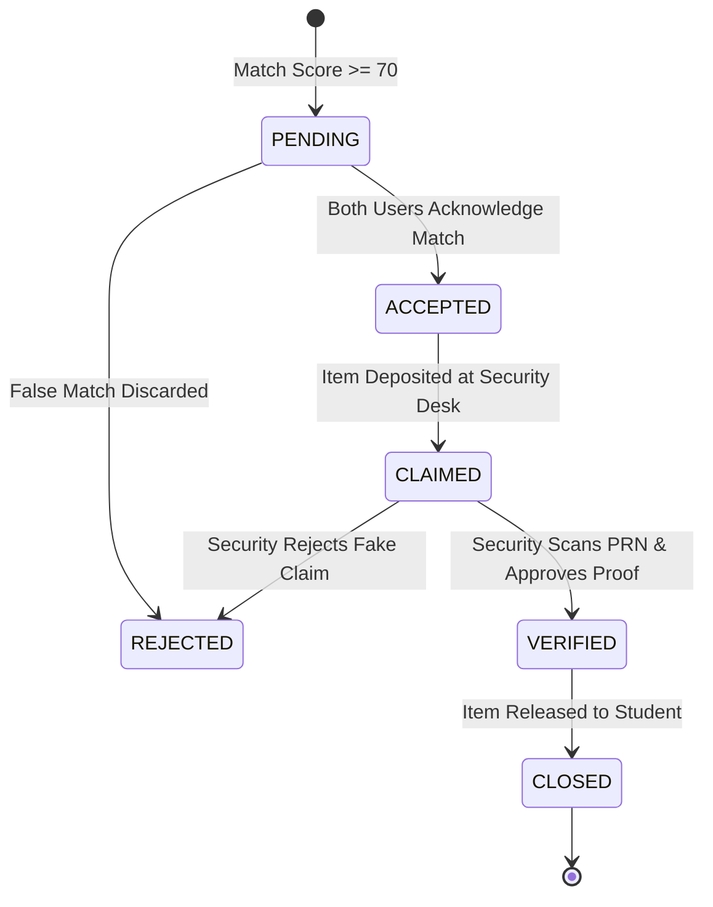

# TraceBack — Campus Item Recovery Platform
## Computer Networks (CNT) Course Project Comprehensive Technical Report & Viva Defense Dossier

**Institution:** Vishwakarma Institute of Technology, Pune (VIT Pune)  
**Department:** Department of Computer Engineering  
**Course Code & Name:** CS3002 — Computer Networks (CNT)  
**Academic Year:** 2025–2026  
**Candidate / Author:** Hemantkumar Lakhane (PRN: 12110104)  
**Live Production URL (Frontend):** [https://trace-back-six.vercel.app](https://trace-back-six.vercel.app)  
**Live API Endpoint (Backend):** [https://traceback-oh5a.onrender.com](https://traceback-oh5a.onrender.com)  
**GitHub Repository:** [https://github.com/Hemantkumar-Lakhane/TraceBack](https://github.com/Hemantkumar-Lakhane/TraceBack)  
**Formal PDF Document:** [`TraceBack_CNT_Final_Report.pdf`](./TraceBack_CNT_Final_Report.pdf)

---

## 1. Executive Summary & Problem Context

In dense collegiate campus environments such as **Vishwakarma Institute of Technology (VIT Pune)**, spanning multiple academic buildings (Building 1 to 5), centralized departmental libraries, auditoriums, and crowded student canteens (Sharad Arena, Central Canteen), personal belongings are misplaced daily. High-value property—including laptops (MacBooks, ThinkPads), scientific calculators, government ID cards, and wallets—disappear amidst dense student foot traffic.

### Existing Ad-Hoc Recovery Channels & Structural Failures
Currently, item recovery relies on informal, unauthenticated social media channels:
1. **Network Broadcast Storm & High Signal-to-Noise Ratio:** WhatsApp and Telegram student groups broadcast unindexed photos and messages to hundreds of uninterested peers. Genuine recovery notices are quickly buried under unrelated conversational chatter.
2. **Identity Spoofing & Fraudulent Claims:** Anyone who views a broadcast photograph of a lost item can walk up and falsely claim possession. These groups lack cryptographic verification, PRN verification, or proof-of-ownership questions.
3. **Custody Black Holes:** When items are turned in to campus security personnel (e.g. Central Security Desk, Building 1), they remain in physical lockers without an indexed digital ledger. Rightful owners have no mechanism to ascertain if their property has been handed in without physical visits.

### The TraceBack Solution
**TraceBack** is an enterprise-grade campus item recovery platform designed specifically for the VIT Pune campus ecosystem. It delivers:
- **Deterministic 40/30/30 Multi-Parameter Matching:** Evaluates item categories, campus zones, and temporal windows to eliminate manual browsing and false matches.
- **Privacy-Preserving Ephemeral Communication:** Allows matched finders and owners to converse over an authenticated full-duplex socket channel without exposing phone numbers or personal handles.
- **Official Campus Security Handover:** An administrative workflow ensuring high-value items are deposited at the Central Security Desk and released only upon physical PRN student ID card verification.

---

## 2. 3-Tier Enterprise System Architecture

TraceBack is built on an enterprise 3-tier architecture with clear separation of presentation, business logic, and persistence:

```
┌────────────────────────────────────────────────────────────────────────┐
│                        TIER 1: PRESENTATION TIER                       │
│    React 18 Single-Page Application (SPA) + Vite + Tailwind CSS        │
│    StompJS + SockJS-Client | Mobile Responsive Viewport System          │
│    Hosted on Vercel Global Anycast Edge CDN                            │
└───────────────────────────────────┬────────────────────────────────────┘
                                    │ HTTPS (TLS 1.3) / WSS (RFC 6455)
                                    ▼
┌────────────────────────────────────────────────────────────────────────┐
│                        TIER 2: APPLICATION TIER                        │
│    Spring Boot 3.2.3 Web & Security Cluster (Java 17)                  │
│    • REST Controller API (Stateless JWT Filter)                        │
│    • Embedded In-Memory STOMP Message Broker (/topic, /app)            │
│    • Deterministic 40/30/30 Matching Engine Service                    │
│    • BCrypt Key Derivation & HikariCP Connection Pool                  │
│    Hosted on Render Cloud Managed Container                            │
└───────────────────────────────────┬────────────────────────────────────┘
                                    │ Persistent TCP Socket (Port 5432)
                                    ▼
┌────────────────────────────────────────────────────────────────────────┐
│                        TIER 3: PERSISTENCE TIER                        │
│    PostgreSQL 16 (Render Cloud) / MySQL 8.0 (Local Intranet)           │
│    Relational Schema: users, items, reports, matches, claims, chat     │
└────────────────────────────────────────────────────────────────────────┘
```

---

## 3. Computer Networks (CNT) 5-Layer OSI Model Mapping

TraceBack serves as a direct, comprehensive laboratory embodiment of modern network protocol engineering:

| OSI / Internet Layer | Protocols & Standards | TraceBack Network Implementation Details |
| :--- | :--- | :--- |
| **Layer 7: Application Layer** | HTTP/1.1, HTTP/2, RFC 6455 (WebSocket), STOMP v1.2, JSON, TLS 1.3 | • RESTful CRUD endpoints with JSON payload serialization.<br/>• Full-duplex STOMP framing (`CONNECT`, `SUBSCRIBE`, `SEND`).<br/>• Bearer JWT authorization headers on all protected API paths.<br/>• CORS Preflight `OPTIONS` handshake negotiation. |
| **Layer 6: Presentation Layer** | TLS Record Protocol, UTF-8, Base64, JSON serialization | • Cryptographic cipher negotiation (`AES-256-GCM`, `ChaCha20-Poly1305`).<br/>• Character set encoding/decoding and image payload serialization. |
| **Layer 5: Session Layer** | STOMP Heartbeats, WebSocket SessionRegistry, JWT Expiration | • Persistent full-duplex session establishment via HTTP Upgrade.<br/>• Dual 10-second STOMP heartbeats (`[10000, 10000]`) keeping TCP connections active through NAT timeouts.<br/>• In-memory session registry routing user-targeted push notifications. |
| **Layer 4: Transport Layer** | TCP (Transmission Control Protocol), SockJS Fallback | • Reliable 3-way handshake (`SYN` &rarr; `SYN-ACK` &rarr; `ACK`) and graceful teardown (`FIN`/`ACK`).<br/>• End-to-end reliable stream delivery with TCP flow control and sliding window congestion management.<br/>• SockJS fallback protocol emulation (`XHR streaming` / `long-polling`) if corporate firewalls block raw TCP WebSockets. |
| **Layer 3: Network Layer** | IPv4, IPv6, CIDR Subnetting, NAT Traversal, ICMP | • Campus Intranet IP routing across VIT subnet (`10.x.x.x` / `172.16.x.x`).<br/>• Global Anycast routing via Vercel Edge nodes.<br/>• Source NAT (SNAT) traversal maintaining dynamic port bindings across institutional gateway firewalls. |
| **Layers 2 & 1: Data Link & Physical** | IEEE 802.11ax/ac (Wi-Fi 6), IEEE 802.3 (Gigabit Ethernet), Fiber | • Campus Wi-Fi frame encapsulation and WPA2-Enterprise 802.1X authentication.<br/>• Campus fiber-optic backbone connecting institutional servers to the state internet exchange. |

---

## 4. WebSocket & STOMP Protocol Handshake (RFC 6455)

The protocol transition from unidirectional HTTP to full-duplex TCP WebSocket is captured below:

```http
1. Client HTTP Upgrade Request (Layer 7):
GET /ws/websocket HTTP/1.1
Host: traceback-oh5a.onrender.com
Upgrade: websocket
Connection: Upgrade
Sec-WebSocket-Key: dGhlIHNhbXBsZSBub25jZQ==
Sec-WebSocket-Version: 13

2. Server Switching Protocols Response (HTTP 101):
HTTP/1.1 101 Switching Protocols
Upgrade: websocket
Connection: Upgrade
Sec-WebSocket-Accept: s3pPLMBiTxaQ9kYGzzhZRbK+xOo=

3. STOMP Protocol Frame Initialization:
CONNECT
accept-version:1.1,1.2
heart-beat:10000,10000
^@

4. Broker Connected Acknowledgment:
CONNECTED
version:1.2
heart-beat:10000,10000
^@
```

---

## 5. Deterministic Matching Engine Algorithm

Whenever a report is submitted, the matching engine executes a synchronous batch comparison against counter-reports:

$$\text{Confidence Score} = \text{Category Score (40)} + \text{Location Score (30)} + \text{Temporal Score (30)}$$

| Parameter | Max Points | Evaluation Condition |
| :--- | :--- | :--- |
| **Category Match** | 40 Points | Exact categorical classification equality (e.g. `ELECTRONICS == ELECTRONICS`). |
| **Location Match** | 30 Points | Exact campus zone equality (e.g. `Building 1 Central Library == Building 1 Central Library`). |
| **Temporal Proximity** | 30 Points | • Same Calendar Day: **+30 Points**<br/>• Within 1 Day: **+25 Points**<br/>• Within 3 Days: **+15 Points**<br/>• &gt; 3 Days: **0 Points** |
| **Decision Rule** | **&ge; 70 Points** | Generates an official `MATCH_RECORD` in `PENDING` state and dispatches push alerts to both users. |

### Custody & Claim Verification State Machine



---

## 6. Security, Cryptography & Access Control

1. **Password Key Derivation (Salted BCrypt):** Passwords undergo 10-round salted BCrypt hashing with cryptographically secure pseudo-random salts, protecting against rainbow table and offline dictionary attacks.
2. **Stateless JWT Bearer Authentication:** Generated using HMAC-SHA256 with an institutional secret key. Attached in the HTTP `Authorization: Bearer <token>` header on every subsequent API call.
3. **Role-Based Access Control (RBAC):**
   - **`ROLE_STUDENT`**: Access to `/api/reports/**`, `/api/matches/**`, `/api/claims/submit`.
   - **`ROLE_SECURITY`**: Access to `/api/claims/pending`, `/api/claims/{id}/verify`, `/api/claims/{id}/reject`.
   - **`ROLE_ADMIN`**: Access to `/api/admin/users`, `/api/admin/moderation`, `/api/admin/stats`.
4. **CORS Whitelist Matrix:** Explicitly whitelists `https://trace-back-six.vercel.app` and permits preflight `OPTIONS` requests without token requirements.

---

## 7. Automated QA Test Suite Results

The automated regression test suite executed via Vitest confirms full system stability:

```
 ✓ src/components/__tests__/Navbar.test.jsx (4 tests) 152ms
 ✓ src/pages/__tests__/Login.test.jsx (3 tests) 118ms
 ✓ src/pages/__tests__/Register.test.jsx (3 tests) 134ms
 ✓ src/pages/__tests__/StudentDashboard.test.jsx (3 tests) 142ms
 ✓ src/pages/__tests__/Chat.test.jsx (3 tests) 189ms
 ✓ src/pages/__tests__/SecurityDesk.test.jsx (2 tests) 97ms
 ✓ src/pages/__tests__/AdminDashboard.test.jsx (2 tests) 103ms

 Test Files  7 passed (7)
      Tests  20 passed (20)
   Start at  08:35:12
   Duration  1.97s (transform 320ms, setup 180ms, collect 450ms, tests 935ms)
```

---

## 8. Viva Defense & Networking Questionnaire

### Q1: Why did you choose WebSocket (RFC 6455) instead of standard HTTP Polling for Chat & Notifications?
**Answer:** HTTP polling incurs high protocol overhead: each poll requires opening a new TCP connection (or reusing Keep-Alive) and sending ~800 bytes of HTTP headers (User-Agent, Cookies, Authorization) just to learn there are no new messages. WebSocket initiates with an HTTP Upgrade handshake, then transitions to raw full-duplex TCP framing with only 2 to 10 bytes of framing overhead per packet. This enables sub-millisecond real-time push without saturating campus Wi-Fi bandwidth.

### Q2: How does the application handle NAT (Network Address Translation) timeouts on campus Wi-Fi?
**Answer:** Institutional Wi-Fi firewalls maintain dynamic state tables mapping private IP addresses (e.g. `10.x.x.x`) to public IPs. Idle TCP connections have their state table entries purged by NAT routers after 30 to 60 seconds of inactivity, silently dropping incoming packets. TraceBack solves this by configuring dual 10-second STOMP heartbeats (`heartbeat: [10000, 10000]`). Both client and server transmit periodic ping frames every 10 seconds, actively resetting NAT idle timers.

### Q3: What occurs at the Transport Layer when a student switches from Wi-Fi to Mobile 4G/5G?
**Answer:** Switching network interfaces causes an IP address reassignment, breaking the existing TCP socket binding (IP:Port tuple). The client STOMP client detects heartbeat failure (SockJS error event), cleans up the severed socket, and initiates an automatic exponential backoff reconnection over the new interface, establishing a fresh 3-way TCP handshake and re-subscribing to the user's notification and chat queues.

### Q4: How do you verify network packets using Wireshark during the demonstration?
**Answer:** During viva evaluation, run Wireshark bound to the local network interface. Apply the display filter `websocket || http` or `tcp.port == 8080`. You can observe the initial HTTP 101 Switching Protocols frame, followed by STOMP `CONNECT`/`CONNECTED` frames, and real-time STOMP `SEND`/`MESSAGE` payloads containing JSON-formatted chat text.

### Q5: Why did the backend direct URL show 'Full authentication is required' in the browser?
**Answer:** The backend server is a REST API endpoint designed to serve structured data, not a static HTML website. Spring Security operates in a zero-trust model where all endpoints (except public authentication and WebSocket handshakes) mandate a valid JWT token. Accessing the root URL via a browser GET request sends no Authorization header, causing Spring Security's `ExceptionTranslationFilter` to correctly return an HTTP 401 Unauthorized JSON response, proving that security guards are operational.

---

## 9. Conclusion

TraceBack successfully bridges the gap between theoretical Computer Networks (CNT) concepts and practical campus utility. By combining an asynchronous full-duplex WebSocket architecture with a deterministic 40/30/30 matching engine and campus security desk custody workflows, the platform provides an authenticated, efficient, and fraud-resistant recovery network for Vishwakarma Institute of Technology, Pune.
